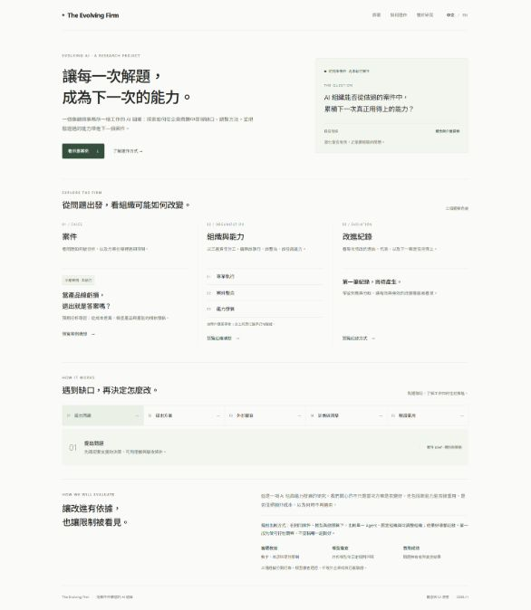
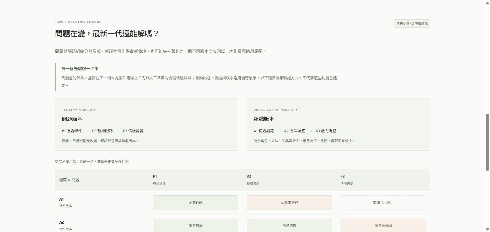

# The Evolving Firm

AI 組織能力發展研究。工作名稱：Evolving AI Consulting Firm。

**研究問題：AI 組織能否從案件中發現能力缺口，取得或建立新能力，並在後續案件中有效重用？**

## 目前進度

Layer 1 中英文首頁原型已完成，延續 Startup Radar／Capability Store 的視覺風格。Layer 2 已加入 F03 歷史合成案例整理，含方案與 Claude 驗證交付材料；已加入本機半自動案件交接器並完成一次合成試行；尚無自主 LLM 調度、獨立多 Agent、能力演化或企業成效結果。

- 案件列表可依狀態篩選並進入 F03 詳情；組織與能力、改進紀錄仍為預覽對話框。
- 五階段互動：提出問題 → 提出方案 → 外部審查 → 診斷與調整 → 驗證重用。
- 示意案例與研究狀態明確標示；三種證據分開說明。
- 問題與組織雙版本、可點選的交叉測試矩陣；矩陣結果完全虛構，非研究成果。
- 規劃首批 10 題、保留舊版本，展示適應／泛化／能力保留。尚未選題或執行。
- 中英文桌面與 320px 手機版已檢查。





## 本機啟動

需要 Node.js（支援 `import.meta.dirname`，例如 Node 22+）。沒有第三方依賴，不需要 npm install。

```powershell
cd D:\evolving-ai\web
npm run dev
```

開啟 http://127.0.0.1:4183/ 。預設中文，英文網址為 http://127.0.0.1:4183/?lang=en 。
伺服器只綁定本機，僅提供 web 目錄內容；結束預覽按 Ctrl+C。

語法檢查：

```powershell
node --check web/src/app.js
node --check web/serve.mjs
```

## 研究設計

- 三層責任：專業執行、案件整合、能力發展；證據與評估提供橫向支援。
- 延用既有 16 種角色規格作為專業底座；本輪改編 A01/A02/A06/A08 的案件契約，另設 CD 能力發展責任；未部署全部角色或獨立多 Agent。
- Junior／Senior／Director 等職級為早期例子，不是固定需求。
- 新增 Agent 是選項之一，先判斷是否缺資料、方法、工具或分工。
- 第一版定位為可行性觀察；單 Agent、固定組織與可調整組織的比較仍待定義與執行。
- 通過模型審查不等於企業成效已驗證。

## 文件入口

| 文件 | 用途 |
|---|---|
| [概念](docs/CONCEPT.md) | 目前概念與研究邊界 |
| [進度](docs/PROGRESS.md) | 已完成、限制與下一步 |
| [目錄](docs/FILE_DIRECTORY.md) | 實際檔案與預留區域 |
| [試行協議草案](experiments/protocols/PILOT.md) | 執行前需確認的評估與預算 |
| [案件模板](cases/templates/CASE_BRIEF.md) | 案件範圍、證據與驗收 |
| [審查模板](reviews/templates/REVIEW.md) | 問題、證據與未解分歧 |
| [展示構想](presentation/DEMO_STORY.md) | 後續案件故事線 |

## 資料與版本

私有資料、金鑰與原始執行紀錄不納入 Git。`data/private/` 與 `runs/` 只保留使用說明。未經確認授權，不傳送私有資料給外部模型。

GitHub：公開 repo https://github.com/vcstseng/evolving-ai 。

網站：https://vcstseng.github.io/evolving-ai/ （英文：?lang=en）。

GitHub Pages 透過 `.github/workflows/pages.yml` 發布，main 的 web/ 或 workflow 更新觸發部署。只發布 index.html、src/ 與經整理的 evidence/ 合成證據；本機伺服器、其他研究文件與私有資料不納入網站 artifact。

## 第一輪範圍收斂
先選一種工作與數個案件，追蹤一次可識別的能力改變，檢查它在未見案件是否可重用，以及舊案是否退步。普通 Agent＋相同工具＋記憶與反思為必要探索性對照，保持相同可用資料、模型、工具權限與總預算。小型試行不支持統計優越性結論。

首批 10 題仍為後續範圍規劃，尚未選定。第一輪不要求建立新 Agent，不必同時完成三組組織比較；自動出題、無限制擴編與版本路由留待後續。首頁雙版本矩陣僅展示測試概念。

## Layer 2｜F03 案件室
[公開案件頁](https://vcstseng.github.io/evolving-ai/?lang=zh&view=case&case=f03)。歷史合成資料、共享上下文角色演練與新演化研究分開標示。最終方案待 Claude 實際回覆，未宣稱通過。先提供原始問題、限制、交付要求與方案給 Claude 審查；CSV 僅為本案核對數字時的選用佐證。

執行 `python scripts/check_f03.py` 可獨立重算總額、六項順序差異並核對 CSV 雜湊；這只驗證算術一致性。

交付依問題定義：方案本身可為完整成果，不要求每題都有 CSV、程式或附件。案件頁以方案 → Claude 審查 → 後續修改為主線。發布狀態以 GitHub Pages 最新部署為準。

## 案件列表與保留版本
[案件列表](https://vcstseng.github.io/evolving-ai/?lang=zh&view=cases) 依待解題、待審查、修改中與待重用測試篩選。目前僅 F03 歷史合成案例，Claude 審查待執行，沒有填入未執行的假案件。

`web/evidence/f03/v1/` 固定既有題目、限制、方案文件與選用資料，文字統一 LF；`manifest.json` 記錄來源提交與 SHA-256。v1 是文件快照，不是 Agent 世代。後續修改另存新版本，保留來源審查、理由與分歧，不覆寫 v1。執行 `python scripts/check_versions.py` 核對保留內容完整性。

案件閱讀順序為問題 → 方案 → 審查與修改 → 版本與組織 → 歷史過程。內部模擬自查不算 Claude 審查，未用來改寫固定方案。

## 本機案件處理已可執行
詳 [本機流程](docs/LOCAL_WORKFLOW.md)。`python -X utf8 -m src.workflow` 提供 start／packet／submit／tool／status／export，按依賴接收交付並留存來源與雜湊。三層責任已在 F03 合成試行完成六步交接，缺口判斷為補證據，未新增角色或能力。

程式只做派工、計算、結構檢查與紀錄，模型工作由同一對話協助交付；結構檢查通過不代表方案品質通過。Claude 審查維持待執行。原始 run 不上傳，網頁只展示白名單摘要；固定方案 v1 不變。模型 token 與成本未量測。
